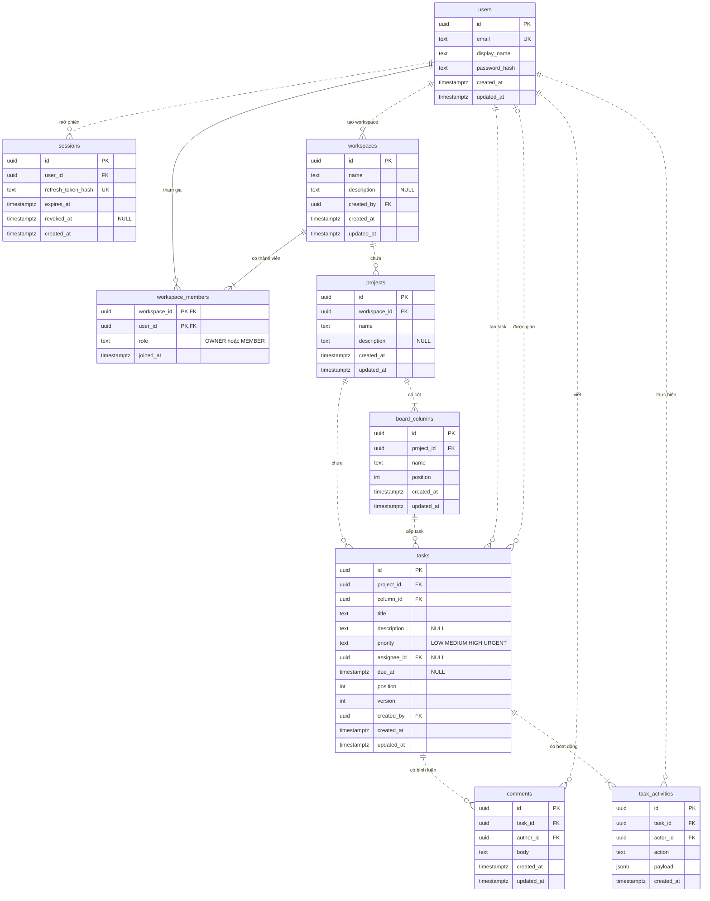

# Sprintly — Mô hình dữ liệu (ERD)

Phạm vi MVP P0 theo [đặc tả Sprintly v1.0](Sprintly_Codex_Implementation_Spec.md), mục 4, 5 và 7. Các mục ghi **Đề xuất** mô tả quyết định thiết kế cần duyệt. Quyền và luồng tương ứng nằm trong [phân tích nghiệp vụ](Sprintly_BA.md) và [Use Case](Sprintly_Use_Cases.md).

## 1. ERD PostgreSQL

`PK` là khóa chính, `FK` là khóa ngoại và `UK` là khóa duy nhất. Các cột mặc định `NOT NULL` trừ trường có nhãn `NULL`. Đường liền biểu thị quan hệ xác định khóa chính của bảng con. Đường đứt biểu thị quan hệ qua khóa ngoại nằm ngoài khóa chính của bảng con.

- Mỗi workspace có tối thiểu một membership với vai trò `OWNER`. Mỗi project mới có đúng ba cột mặc định `To Do`, `In Progress`, `Done` và có thể thêm cột. Một task thuộc đúng một project, nằm ở đúng một cột của project đó và có thể có một assignee. Khi giao dịch tạo task thành công, task có ít nhất bản ghi hoạt động tạo task. Backend áp dụng số lượng tối thiểu ở cấp giao dịch.
- Các khóa ngoại `created_by`, `author_id` và `actor_id` trỏ tới `users.id` để lưu danh tính tác giả. Quyền truy cập hiện tại lấy từ `workspace_members`. Ứng dụng định dạng múi giờ địa phương khi hiển thị. API trao đổi thời gian theo UTC ISO-8601.
- **Đề xuất** chọn `timestamptz` cho thời điểm, `text` cho chuỗi và dùng khóa chính ghép `(workspace_id, user_id)` cho `workspace_members` để thực thi yêu cầu duy nhất của đặc tả. `revoked_at = NULL` biểu thị phiên chưa bị thu hồi, còn hiệu lực phụ thuộc thêm vào `expires_at`.

## 2. Ràng buộc và chỉ mục

| Phạm vi | Yêu cầu v1.0 |
|---|---|
| Tài khoản | Chuẩn hóa email bằng trim và lowercase trước khi ghi hoặc tra cứu. Email là duy nhất. Lưu password hash và refresh token hash. Refresh token hash là duy nhất. |
| Thành viên | Mỗi user có tối đa một membership trong một workspace. Vai trò thuộc tập `OWNER`, `MEMBER`. Khởi tạo workspace cùng membership `OWNER` của người tạo. Bảo đảm còn ít nhất một owner trong workspace đang tồn tại. Owner tra cứu theo email khớp chính xác sau chuẩn hóa và thêm người dùng đã tồn tại qua `user_id` với vai trò `MEMBER`. |
| Phân quyền | Xác thực quyền trên server. Với task và dữ liệu con, kiểm tra theo task → project → workspace → membership. Truy vấn tìm kiếm giới hạn trong phạm vi người dùng có quyền. |
| Task | Cột phải thuộc project của task. Assignee, nếu có, phải là thành viên workspace của project. Trạng thái được biểu diễn bằng `column_id`. Priority thuộc tập `LOW`, `MEDIUM`, `HIGH`, `URGENT`. |
| Đầu vào | Title task 1–150 ký tự, tên workspace/project 1–100 ký tự và nội dung bình luận 1–2000 ký tự. Validate ở client và server. |
| Audit | Ghi hoạt động tạo, sửa, di chuyển và thay đổi người được giao trên server. Audit chỉ thêm trong vòng đời task. |

**Chỉ mục tối thiểu theo v1.0**

| Bảng | Cột theo thứ tự |
|---|---|
| `workspace_members` | `(user_id)` |
| `projects` | `(workspace_id)` |
| `board_columns` | `(project_id, position)` |
| `tasks` | `(project_id, column_id, position)`, `(assignee_id, due_at)` |
| `comments` | `(task_id, created_at)` |
| `task_activities` | `(task_id, created_at)` |

**Đề xuất**

- Thêm ràng buộc duy nhất `board_columns(project_id, id)` để làm đích cho khóa ngoại ghép `tasks(project_id, column_id)`. `tasks.project_id` đồng thời tham chiếu `projects.id`. Hai khóa này bảo vệ quan hệ task–project–cột ngay tại PostgreSQL.
- `tasks.assignee_id` tham chiếu `users.id`. Backend kiểm tra membership trong cùng giao dịch ghi task và tuần tự hóa thao tác với việc xóa member. Dùng khóa trên bản ghi workspace cho các thao tác này để hai giao dịch cùng workspace không thể xen giữa bước kiểm tra và bước ghi.
- Thực thi tập giá trị role/priority và `position >= 0`, `version >= 1` ở PostgreSQL. Khởi tạo task ở `version = 1`. Sắp xếp theo `position, id` trong từng cột, hoặc theo `created_at, id` cho bình luận và hoạt động theo chiều của endpoint. Có thể kiểm tra tính duy nhất của `(project_id, position)` cho cột và `(column_id, position)` cho task ở cuối giao dịch để tránh va chạm tạm thời khi cập nhật nhiều vị trí.

## 3. Giao dịch và vòng đời dữ liệu

### Yêu cầu v1.0

- Tạo project và ba cột mặc định trong cùng giao dịch. Nếu một bước thất bại, rollback toàn bộ.
- Sửa và di chuyển task kiểm tra `expectedVersion`; phiên bản cũ trả `409`. Di chuyển lưu thứ tự trong giao dịch và cập nhật phiên bản task. Ứng dụng rollback hoặc tải lại khi có lỗi.
- Refresh token phải được xoay vòng, token cũ phải mất hiệu lực và logout phải thu hồi phiên tương ứng.

### Đề xuất

| Thao tác | Ranh giới giao dịch và kết quả |
|---|---|
| Tạo workspace | Ghi workspace và membership `OWNER` của người tạo cùng giao dịch. |
| Xoay refresh token | Kiểm tra hash, hạn dùng và trạng thái thu hồi trong cùng giao dịch. Thay hash trên bản ghi phiên hiện tại sau khi kiểm tra thành công. Hai yêu cầu dùng cùng token cũ chỉ có tối đa một yêu cầu thành công. |
| Tạo/sửa/giao task | Kiểm tra quyền, cột và membership của assignee trong giao dịch. Khi sửa, cập nhật với điều kiện `version = expectedVersion` và tăng `version` trong cùng lần ghi để hai yêu cầu dùng cùng phiên bản không thể cùng thành công. Ghi hoạt động tương ứng trong cùng giao dịch với thay đổi task. |
| Di chuyển task | Tuần tự hóa thay đổi thứ tự trong workspace, kiểm tra phiên bản và lấy thứ tự cột hiện tại từ server. Hỗ trợ di chuyển cùng cột. `targetIndex` bắt đầu từ 0, tính trên danh sách đích sau khi lấy task đang kéo ra nếu cùng cột. Với `n` task còn lại, chấp nhận chỉ số từ 0 đến `n`, gồm vị trí chèn cuối. Trả `422` nếu chỉ số nguyên nằm ngoài khoảng hoặc cột đích vi phạm phạm vi project. Trả `409` nếu phiên bản cũ. |
| Đánh lại vị trí | Vị trí liên tục từ 0 trong từng cột tại thời điểm commit. Tạo, xóa và di chuyển task dùng cùng cơ chế tuần tự hóa khi đổi thứ tự. Tạo task ở cuối cột, xóa task thì dồn vị trí của cột còn tồn tại. Khi di chuyển, cập nhật cột, vị trí, `version` và audit cho task đang thao tác. Vị trí các task lân cận có thể đổi mà không tăng `version` của chúng. Client đối chiếu hoặc tải lại board để nhận thứ tự chính thức. |
| Xóa member | Owner kiểm tra điều kiện owner cuối cùng, gỡ `assignee_id` trên các task liên quan trong workspace, tăng `version`, cập nhật `updated_at` và ghi audit cho từng thay đổi assignee với Owner là actor, rồi xóa membership trong cùng giao dịch. Tài khoản, tác giả, bình luận và lịch sử đã ghi được giữ lại. |
| Xóa workspace, project hoặc task | Sau kiểm tra quyền, hard delete trong cùng giao dịch. Xóa workspace kéo theo memberships và projects. Xóa project kéo theo cột và task. Xóa task kéo theo bình luận và audit của task. Chính sách này giới hạn lịch sử theo vòng đời task và cần duyệt cùng yêu cầu lưu trữ audit. |

**Đề xuất quyền P0.** `OWNER` quản lý workspace và membership, đồng thời có quyền xóa project. Cả `OWNER` và `MEMBER` có thể tạo/sửa project, thêm/đổi tên cột, tạo/sửa/giao task, di chuyển và bình luận trong workspace. Xóa task do `OWNER` hoặc người tạo task vẫn còn là thành viên workspace.

## 4. Room trên Android

| Dữ liệu server | Room entity | Phạm vi |
|---|---|---|
| `workspaces` | `CachedWorkspaceEntity` | Danh sách và chi tiết workspace đã đồng bộ. |
| `workspace_members` và thông tin user hiển thị | `CachedMemberEntity` | Danh sách thành viên của workspace đã đồng bộ. |
| `projects` | `CachedProjectEntity` | Project đã đồng bộ theo workspace. |
| `board_columns` | `CachedColumnEntity` | Cột và thứ tự theo project. |
| `tasks` | `CachedTaskEntity` | Cột, vị trí, phiên bản và trường hiển thị đã nhận từ server. |
| `comments` | `CachedCommentEntity` | Tùy chọn theo lượng dữ liệu. |

- **v1.0.** Room lưu bản sao dữ liệu được phép đọc và UI có thể quan sát qua Flow. Làm mới từ server rồi cập nhật cache theo giao dịch. Offline P0 chỉ đọc dữ liệu đã đồng bộ. Server quyết định trạng thái chính thức, thứ tự và quyền truy cập khi làm mới.
- **Đề xuất.** Dùng một Room database chứa `accountId` trong khóa và mọi truy vấn cache. Khóa gợi ý là `(accountId, id)`, riêng member là `(accountId, workspaceId, userId)`. Nếu dùng khóa ngoại cục bộ, đưa `accountId` vào quan hệ cha–con. Áp dụng dữ liệu làm mới theo phạm vi response để dọn các bản ghi đã xóa hoặc mất quyền khi server xác nhận.
- **Đề xuất.** Khi logout hoặc refresh thất bại đến mức kết thúc phiên, đóng quyền đọc của phiên, hủy refresh đang chạy và xóa cache theo `accountId`. Ràng buộc kết quả refresh với phiên đã khởi tạo request để response đến muộn không ghi lại dữ liệu đã xóa. Token lưu theo cơ chế phiên bảo mật của Android.
