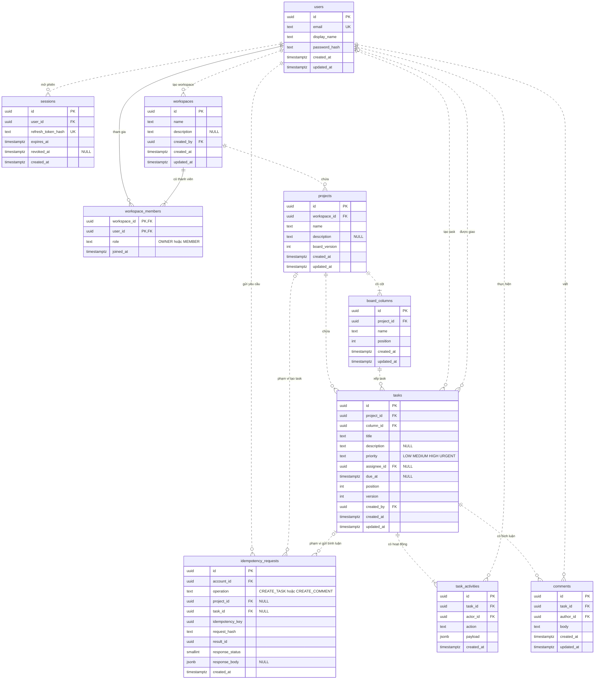

# Sprintly — Mô hình dữ liệu (ERD)

Phạm vi MVP P0 theo [đặc tả Sprintly v1.0](Sprintly_Codex_Implementation_Spec.md), mục 4, 5 và 7. Các mục ghi **Đề xuất kỹ thuật** mô tả cách triển khai gợi ý. Quyền và luồng tương ứng nằm trong [phân tích nghiệp vụ](Sprintly_BA.md) và [Use Case](Sprintly_Use_Cases.md).

## 1. ERD PostgreSQL

`PK` là khóa chính, `FK` là khóa ngoại và `UK` là khóa duy nhất. Các cột mặc định `NOT NULL` trừ trường có nhãn `NULL`. Đường liền biểu thị quan hệ xác định khóa chính của bảng con. Đường đứt biểu thị quan hệ qua khóa ngoại nằm ngoài khóa chính của bảng con.

- Mỗi workspace có tối thiểu một membership với vai trò `OWNER`. Mỗi project mới có đúng ba cột mặc định `To Do`, `In Progress`, `Done` và có thể thêm cột. Một task thuộc đúng một project, nằm ở đúng một cột của project đó và có thể có một assignee. Khi giao dịch tạo task thành công, task có ít nhất bản ghi hoạt động tạo task. Backend áp dụng số lượng tối thiểu ở cấp giao dịch.
- Các khóa ngoại `created_by`, `author_id` và `actor_id` trỏ tới `users.id` để lưu danh tính tác giả. Quyền truy cập hiện tại lấy từ `workspace_members`. Ứng dụng định dạng múi giờ địa phương khi hiển thị. API trao đổi thời gian theo UTC ISO-8601.
- **Đề xuất kỹ thuật.** Dùng `timestamptz` cho thời điểm, `text` cho chuỗi và khóa chính ghép `(workspace_id, user_id)` cho `workspace_members`. `revoked_at = NULL` biểu thị phiên chưa bị thu hồi, còn hiệu lực phụ thuộc thêm vào `expires_at`.

## 2. Ràng buộc và chỉ mục

| Phạm vi | Yêu cầu v1.0 |
|---|---|
| Tài khoản | Chuẩn hóa email bằng trim và lowercase trước khi ghi hoặc tra cứu. Email là duy nhất. Lưu password hash và refresh token hash. Refresh token hash là duy nhất. |
| Thành viên | Mỗi user có tối đa một membership trong một workspace. Vai trò thuộc tập `OWNER`, `MEMBER`. Khởi tạo workspace cùng membership `OWNER` của người tạo. Bảo đảm còn ít nhất một owner trong workspace đang tồn tại. Chỉ `OWNER` của workspace đích được tra email khớp chính xác sau chuẩn hóa để thêm người dùng đã đăng ký qua `user_id` với vai trò `MEMBER`. |
| Phân quyền | Xác thực quyền trên server. Với task và dữ liệu con, kiểm tra theo task → project → workspace → membership. Truy vấn tìm kiếm giới hạn trong phạm vi người dùng có quyền. |
| Board | `projects.board_version` khởi tạo bằng `1`. API trả tên `boardVersion`. Cột, thứ tự task và `boardVersion` trong phản hồi GET board đến từ cùng một snapshot đã commit. |
| Task | Cột phải thuộc project của task. Assignee, nếu có, phải là thành viên workspace của project. Trạng thái được biểu diễn bằng `column_id`. Priority thuộc tập `LOW`, `MEDIUM`, `HIGH`, `URGENT`. |
| Đầu vào | Title task 1–150 ký tự, tên workspace/project 1–100 ký tự và nội dung bình luận 1–2000 ký tự. Validate ở client và server. |
| Audit | Ghi hoạt động tạo, sửa, di chuyển và thay đổi người được giao trên server. Audit chỉ thêm trong vòng đời task và bị xóa cùng task. |
| Thử lại thao tác tạo | `idempotency_requests.account_id` tham chiếu `users.id`. `CREATE_TASK` yêu cầu `project_id` và để `task_id` là `NULL`. `CREATE_COMMENT` yêu cầu `task_id` và để `project_id` là `NULL`. Khóa ngoại đến project và task xóa dây chuyền theo tài nguyên cha. `result_id` lưu ID của kết quả và tồn tại theo vòng đời bản ghi yêu cầu, kể cả khi task đã tạo bị xóa. `response_body` chỉ chuyển về `NULL` khi xóa task đã tạo. |

**Chỉ mục tối thiểu theo v1.0**

| Bảng | Cột theo thứ tự |
|---|---|
| `workspace_members` | `(user_id)` |
| `projects` | `(workspace_id)` |
| `board_columns` | `(project_id, position)` |
| `tasks` | `(project_id, column_id, position)`, `(assignee_id, due_at)` |
| `comments` | `(task_id, created_at)` |
| `task_activities` | `(task_id, created_at)` |
| `idempotency_requests` | Unique `(account_id, operation, project_id, idempotency_key)` cho `CREATE_TASK` và unique `(account_id, operation, task_id, idempotency_key)` cho `CREATE_COMMENT`. |

**Đề xuất kỹ thuật**

- Thêm ràng buộc duy nhất `board_columns(project_id, id)` để làm đích cho khóa ngoại ghép `tasks(project_id, column_id)`. `tasks.project_id` đồng thời tham chiếu `projects.id`. Hai khóa này bảo vệ quan hệ task–project–cột ngay tại PostgreSQL.
- `tasks.assignee_id` tham chiếu `users.id`. Backend kiểm tra membership trong cùng giao dịch ghi task và tuần tự hóa thao tác với việc xóa member. Dùng khóa trên bản ghi workspace cho các thao tác này để hai giao dịch cùng workspace không thể xen giữa bước kiểm tra và bước ghi.
- Thực thi tập giá trị role/priority và `position >= 0`, `version >= 1` ở PostgreSQL. Khởi tạo task ở `version = 1`. Sắp xếp theo `position, id` trong từng cột, hoặc theo `created_at, id` cho bình luận và hoạt động theo chiều của endpoint. Có thể kiểm tra tính duy nhất của `(project_id, position)` cho cột và `(column_id, position)` cho task ở cuối giao dịch để tránh va chạm tạm thời khi cập nhật nhiều vị trí.
- Khi xoay refresh token, thay `refresh_token_hash` trên bản ghi phiên hiện tại trong cùng giao dịch kiểm tra token. Yêu cầu thu hồi cần nhận diện phiên qua việc xoay token để thu hồi đúng phiên nếu refresh đã hoàn tất trước đó.

## 3. Giao dịch và vòng đời dữ liệu

### Quy tắc P0

| Thao tác | Ranh giới giao dịch và kết quả |
|---|---|
| Tạo workspace | Ghi workspace và membership `OWNER` của người tạo cùng giao dịch. |
| Tạo project | Ghi project với `board_version = 1` và ba cột mặc định trong cùng giao dịch. Rollback toàn bộ nếu một bước thất bại. |
| Xoay và thu hồi refresh token | Kiểm tra hash, hạn dùng và trạng thái thu hồi trong cùng giao dịch. Khi refresh thành công, cấp token mới và vô hiệu token cũ. Hai yêu cầu dùng cùng token cũ chỉ có tối đa một yêu cầu thành công. Thực thi refresh và thu hồi tuần tự trên cùng phiên. Logout được máy chủ xác nhận khi phiên tương ứng đã bị thu hồi. |
| Tạo/sửa/giao task | Kiểm tra quyền, cột và membership của assignee trong giao dịch. Khi sửa, kiểm tra `expectedVersion` và tăng `version` trong cùng giao dịch. Nếu yêu cầu sửa chuyển task sang cột khác, kiểm tra thêm `expectedBoardVersion` rồi chèn task vào cuối cột đích bằng cùng logic cập nhật vị trí của thao tác di chuyển. Trả `409` nếu phiên bản cần kiểm tra đã cũ. Ghi hoạt động tương ứng trong cùng giao dịch với thay đổi task. |
| Di chuyển task | Tuần tự hóa thay đổi thứ tự theo project. Kiểm tra `expectedVersion` và `expectedBoardVersion` rồi lấy thứ tự cột hiện tại trong cùng giao dịch. Hỗ trợ di chuyển cùng cột. `targetIndex` bắt đầu từ 0, tính trên danh sách đích sau khi lấy task đang kéo ra nếu cùng cột. Với `n` task còn lại, chấp nhận chỉ số từ 0 đến `n`, gồm vị trí chèn cuối. Trả `422` nếu chỉ số nguyên nằm ngoài khoảng hoặc cột đích vi phạm phạm vi project. Trả `409` nếu một trong hai phiên bản đã cũ. |
| Thứ tự và phiên bản board | Tuần tự hóa theo project các thao tác tạo, xóa, đổi vị trí hoặc đổi cột của task và thêm cột. Tạo task ở cuối cột. Xóa task thì dồn vị trí của cột còn tồn tại. Vị trí liên tục từ 0 trong từng cột tại thời điểm commit. Tăng `board_version` trong cùng giao dịch với mỗi thay đổi trên. Khi di chuyển, cập nhật cột, vị trí, `version` và audit cho task đang thao tác. Dồn vị trí các task lân cận giữ nguyên `version` của chúng. Client đối chiếu hoặc tải lại board để nhận thứ tự chính thức. |
| Tạo task hoặc gửi bình luận có `Idempotency-Key` | Client dùng một UUID ngẫu nhiên cho mỗi thao tác và gửi lại cùng key khi chưa biết kết quả. Sau khi kiểm tra quyền hiện tại với tài nguyên cha, tìm theo tài khoản, thao tác, tài nguyên cha và key. Cùng key và cùng payload trả lại trạng thái HTTP và nội dung thành công đã lưu. Cùng key và payload khác trả `409`. Nếu task từng tạo đã bị xóa, lần thử lại với cùng key và payload trả `404`. Ghi mã băm của payload và kết quả thành công trong cùng giao dịch với thay đổi nghiệp vụ và audit theo yêu cầu của thao tác. Ràng buộc duy nhất và cách xử lý xung đột trong giao dịch bảo đảm nhiều yêu cầu đồng thời chỉ tạo một kết quả. |
| Xóa member | Owner kiểm tra điều kiện owner cuối cùng, gỡ `assignee_id` trên các task liên quan trong workspace, tăng `version`, cập nhật `updated_at` và ghi audit cho từng thay đổi assignee với Owner là actor, rồi xóa membership trong cùng giao dịch. Tài khoản, tác giả, bình luận và lịch sử đã ghi được giữ lại. |
| Xóa workspace, project hoặc task | Sau kiểm tra quyền, hard delete trong cùng giao dịch. Xóa workspace kéo theo membership và project. Xóa project kéo theo cột, task và bản ghi `CREATE_TASK` của project. Xóa task kéo theo bình luận, audit và bản ghi `CREATE_COMMENT` của task. Nếu project còn tồn tại, dọn `response_body` của yêu cầu `CREATE_TASK` tương ứng trong cùng giao dịch xóa task và giữ khóa chống ghi lặp suốt vòng đời project. |

**Quyền P0.** `OWNER` quản lý workspace và membership, đồng thời có quyền xóa project. Cả `OWNER` và `MEMBER` có thể tạo/sửa project, thêm/đổi tên cột, tạo/sửa/giao task, di chuyển và bình luận trong workspace. Xóa task do `OWNER` hoặc người tạo task vẫn còn là thành viên workspace.

## 4. Room trên Android

| Dữ liệu server | Snapshot Room | Phạm vi |
|---|---|---|
| `workspaces` | `workspaces`, `workspace` | Danh sách đầy đủ và chi tiết workspace đã đồng bộ. |
| `workspace_members` và thông tin user hiển thị | `members` | Danh sách thành viên theo workspace. |
| `projects` | `projects`, `project` | Danh sách theo workspace và chi tiết từng project. |
| `board_columns` và `tasks` | `board` | Cột, task và `boardVersion` được lưu chung. Chi tiết task đọc từ snapshot board. |

- Room cách ly cache theo tài khoản. UI có thể quan sát dữ liệu đã đồng bộ qua Flow. Cập nhật cache trong một giao dịch theo snapshot và phạm vi phản hồi. Dọn dữ liệu workspace bị mất quyền khi máy chủ xác nhận, kể cả khi workspace vắng mặt trong danh sách quyền đã tải đầy đủ.
- Lỗi mạng, timeout hoặc phản hồi `5xx` khi refresh token giữ phiên cục bộ ở chế độ chỉ đọc cache của tài khoản hiện tại. Nếu máy chủ đã xoay token nhưng client không nhận được phản hồi, lần thử sau có thể bị từ chối với token cũ và yêu cầu đăng nhập lại.
- Khi server xác nhận refresh token hết hạn, bị thu hồi hoặc không hợp lệ, hoặc khi người dùng đăng xuất, khóa quyền đọc cache ngay, xóa phiên cục bộ và dọn cache của tài khoản. Logout cục bộ hoàn tất cả khi offline. Chỉ xác nhận thu hồi trên máy chủ khi yêu cầu logout đã được máy chủ xử lý thành công.
- Mã hóa refresh token bằng khóa Android Keystore. Chỉ ghi token hoặc cache từ phản hồi nếu lần đăng nhập đã khởi tạo yêu cầu vẫn đang hoạt động. Việc kiểm tra và ghi phải được đồng bộ với khóa phiên và dọn cache, kể cả khi người dùng đăng nhập lại cùng tài khoản.
- Phase 4 dùng bảng Room `offline_snapshots` trong thư mục loại khỏi sao lưu. Khóa gồm ID lần đăng nhập, loại snapshot, workspace và project. ID lần đăng nhập đi cùng phiên trong kho mã hóa để đọc được dữ liệu sau khi mở lại ứng dụng. Đăng nhập lần mới tạo ID mới, kể cả với cùng tài khoản. Bình luận và lịch sử tải từ máy chủ.
