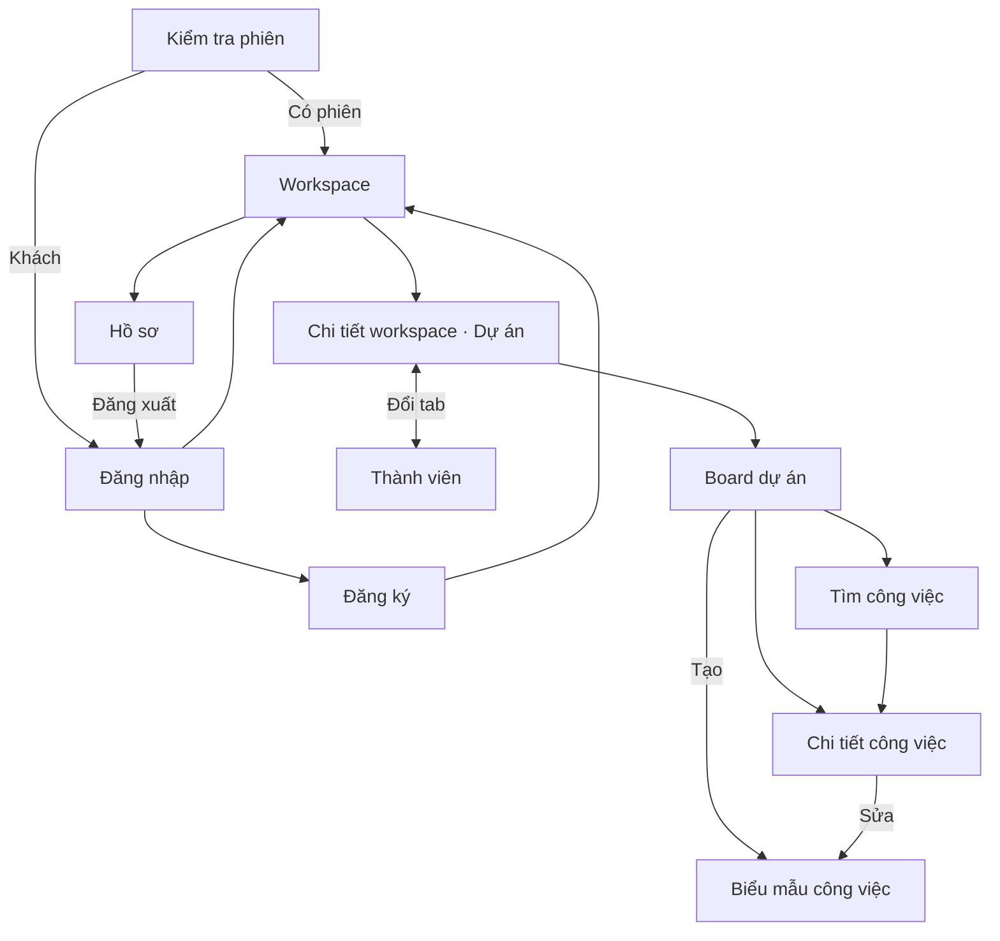

# Sprintly — Nghiên cứu và thiết kế UI/UX Android

Bản thiết kế đề xuất cho nhóm phát triển phần mềm nhỏ quản lý tiến độ theo Kanban. Luồng chính là vào workspace, mở dự án, tạo và giao việc, di chuyển thẻ, rồi kiểm tra bình luận hoặc lịch sử. P0 dùng Android Kotlin, XML Views, Fragments và Material Components. Nội dung giao diện dùng tiếng Việt, giữ tên ba cột mặc định do đặc tả quy định. [Đặc tả sản phẩm](Sprintly_Codex_Implementation_Spec.md) · [Phân tích nghiệp vụ](Sprintly_BA.md) · [Use Case](Sprintly_Use_Cases.md) · [ERD](Sprintly_ERD.md)

**Thiết kế đã chốt ngày 17/11/2026.** Dùng bản Orbix để đối chiếu bố cục, màu sắc, thành phần và điều hướng khi triển khai Android. Bản có 11 màn hình MVP cùng hai màn hình đề xuất **Tổng quan** và **Lịch công việc**, được đánh dấu trong bản xem trước. [Bản thiết kế Orbix](Sprintly_Orbix_Design.html) · [Hệ thống thiết kế Sprintly](../design-system/sprintly/MASTER.md)

## Nghiên cứu và phương án

- Nghiên cứu với `ui-ux-pro-max` định hướng Flat Design cho công cụ quản lý công việc. Bản Orbix dùng Roboto, nền trắng, xanh chanh **#A4ED65** cho nút thêm và tím **#4736C5** cho tab đang chọn. Bảng dự án dùng cụm avatar và thanh tiến độ. [Hệ thống thiết kế](../design-system/sprintly/MASTER.md)
- Dùng vùng chạm ít nhất 48 × 48dp cho biểu tượng, nút, chip và tay nắm kéo. Nút chỉ có biểu tượng cần tên truy cập. Trạng thái cột, lỗi, ưu tiên và quyền có nhãn chữ. Khi chữ lớn, cho nhãn tự xuống dòng, giữ nội dung nhập và nút lưu cuộn tới được. Áp dụng window insets cho thanh công cụ, nội dung sát cạnh, nút cuối và bàn phím. [Tiếp cận trong Android Views](https://developer.android.com/guide/topics/ui/accessibility/views/apps-views) · [Edge-to-edge và window insets](https://developer.android.com/develop/ui/views/layout/edge-to-edge)
- Hai điểm cần kiểm tra trên thiết bị là thao tác di chuyển khi bật TalkBack hoặc dùng bàn phím và điền thông tin bằng trình quản lý mật khẩu. Thiết kế cung cấp lệnh **Di chuyển** cho cùng kết quả với cử chỉ kéo, hỗ trợ dán và tự điền mật khẩu, đồng thời giữ nhãn hiển thị cho mỗi ô nhập. [Nguyên tắc tiếp cận trong Android Views](https://developer.android.com/guide/topics/ui/accessibility/views/principles-views) · [Kéo thả trong Android Views](https://developer.android.com/develop/ui/views/touch-and-input/drag-drop/view) · [Android Autofill](https://developer.android.com/identity/autofill/autofill-optimize)
- Luồng offline dựa trên đặc tả P0 và UC-12. Cache theo tài khoản được hiển thị ngay khi có bản sao. Banner nêu rõ chế độ chỉ đọc, mỗi lỗi nêu hành động tiếp theo. [Đặc tả §7](Sprintly_Codex_Implementation_Spec.md#7-offline--sync-behavior) · [UC-12](Sprintly_Use_Cases.md#uc-12-xem-offline-và-làm-mới-khi-trở-lại-online)

### Tham khảo Backlog Mobile

Backlog gom thông tin, bình luận và tệp vào cùng màn hình chi tiết. Bản iOS cho phép chạm vào thuộc tính để cập nhật ngay. Điều hướng dự án và tìm kiếm nằm ở vùng dễ tiếp cận phía trên. Bản Android cũng kết hợp các khối thông tin trên một màn hình và nhấn mạnh tìm kiếm, bộ lọc. [Backlog iOS](https://backlog.com/ja/blog/backlog-update-ios-renewal/) · [Backlog Android](https://backlog.com/ja/blog/backlog-update-android-renewal/)

Sprintly áp dụng mẫu này vào một màn hình chi tiết cuộn dọc với thuộc tính, mô tả, bình luận và lịch sử. Đặt lối **Tìm và lọc công việc** ngay dưới tiêu đề dự án. Cho phép mở sheet sửa ưu tiên, người phụ trách và hạn từ từng hàng. Hàng cột mở luồng **Di chuyển** để dùng chung xử lý thứ tự và xung đột. Tệp đính kèm thuộc P2 và sẽ có một khối riêng trong trang chi tiết.

| Phương án board trên điện thoại | Lợi ích | Đánh đổi |
| --- | --- | --- |
| Cột ngang có lộ cột kế tiếp và chip tới cột | Thấy luồng Kanban, kéo trực tiếp giữa cột, dễ nhảy đến cột xa | Cần xử lý vùng kéo, cuộn sát mép và vị trí thả |
| Một cột trên màn, đổi qua tab | Cột rộng, ưu tiên đọc từng danh sách | Khó quan sát và thả trực tiếp vào cột khác |
| Danh sách dọc chia theo trạng thái | Dễ cuộn và duyệt tuần tự bằng TalkBack | Khó nắm tiến độ giữa nhiều cột, kéo xa theo chiều dọc |

Chọn **cột ngang có lộ cột kế tiếp và chip tới cột** cho P0 theo §6.3. Với độ rộng 360/390/440dp, giữ cột đang xem đủ rộng cho tên việc và thông tin giao việc. Lộ một phần cột bên khi có cột liền kề. Khi nằm ngang trên điện thoại, để cột hiển thị theo chiều rộng khả dụng và giữ cuộn dọc trong từng cột. Bố cục tablet/large screen là P2 theo đặc tả.

## Cấu trúc điều hướng

Thanh công cụ hiển thị tiêu đề theo ngữ cảnh, nút Quay lại ở màn con và hành động theo màn. Danh sách workspace là gốc sau đăng nhập. Chi tiết workspace mặc định mở tab **Dự án**, tab **Thành viên** nằm cùng cấp. Bản Orbix minh họa thanh điều hướng dưới với các đích **Tổng quan**, **Dự án**, **Lịch**, **Hồ sơ** và nút **Tạo công việc** ở giữa. **Tổng quan** và **Lịch** mang nhãn đề xuất. Tìm kiếm mở từ board và giới hạn theo dự án.

Back và Up trả về nguồn mở màn, giữ tab, vị trí cuộn, cột đang xem, truy vấn và chip lọc. Đóng picker hoặc hộp thoại trước khi rời màn. Đổi tab giữ vị trí cuộn riêng của từng tab. Sau đăng nhập hoặc đăng ký, đặt danh sách workspace làm gốc. Đăng xuất hoặc phiên bị thu hồi đặt màn đăng nhập làm gốc và chặn truy cập cache cũ. Khôi phục trạng thái có thể tái tạo khi xoay hoặc trở lại app, gồm biểu mẫu đang nhập trong phiên hiện tại. Trường mật khẩu dùng cơ chế lưu trạng thái phù hợp với dữ liệu nhạy cảm và được xóa khi rời luồng xác thực.

## Màn hình và trạng thái P0

Lần tải đầu dùng chỉ báo tải hoặc skeleton theo bố cục. Khi làm mới và có dữ liệu, giữ nội dung và báo tiến trình riêng. Phản hồi thành công rỗng hiển thị theo ngữ cảnh. Timeout, lỗi mạng hoặc lỗi máy chủ có nút **Thử lại**. Gửi biểu mẫu khóa nút tương ứng trong lúc chờ và giữ dữ liệu đã nhập nếu thất bại. Đưa focus tới ô lỗi đầu tiên và đọc thông báo gắn với ô. Sau thành công, cập nhật dữ liệu trước khi đóng lớp thao tác hoặc điều hướng.

Cùng một mã ưu tiên dùng cùng nhãn trên thẻ, chi tiết, biểu mẫu và bộ lọc. LOW là **Thấp**, MEDIUM là **Trung bình**, HIGH là **Cao**, URGENT là **Khẩn cấp**. Hành động vượt quyền được bỏ khỏi menu. Hành động hợp lệ tạm thời bị khóa khi offline hoặc đang gửi và có trạng thái giải thích.

### 1. Kiểm tra phiên · session

Hiển thị biểu trưng Sprintly và “Đang kiểm tra phiên…”. Khi đã có phiên hợp lệ, mở workspace thẳng. Khi chưa lưu phiên hoặc máy chủ từ chối refresh dứt khoát, mở **Đăng nhập**. Với phiên đã bị từ chối, hiển thị “Phiên đã hết hạn. Vui lòng đăng nhập lại.”

Lỗi mạng, timeout hoặc lỗi máy chủ tạm thời khi refresh giữ phiên cục bộ theo đề xuất QD-06. Mở danh sách workspace đã lưu nếu có. Nếu chưa có dữ liệu, hiển thị “Kết nối mạng để tải workspace” và **Thử lại**. Thời gian chờ kết thúc ở một trong các trạng thái có lối đi tiếp. [UC-02 và UC-12](Sprintly_Use_Cases.md) · [QD-06](Sprintly_BA.md#6-quyết-định-đề-xuất-để-duyệt)

### 2. Đăng nhập · login

Biểu trưng, tiêu đề, ô **Email**, **Mật khẩu**, nút **Đăng nhập** và liên kết **Tạo tài khoản**. Dùng bàn phím email, autofill, dán và nút “Hiện mật khẩu” hoặc “Ẩn mật khẩu”. Lỗi định dạng đặt dưới ô tương ứng. Lỗi xác thực dùng “Email hoặc mật khẩu chưa đúng”. Khi offline hiển thị “Kết nối mạng để đăng nhập”. Thành công mở workspace. Back ở gốc theo hành vi Android. [UC-02](Sprintly_Use_Cases.md#uc-02-đăng-nhập-và-khôi-phục-phiên)

### 3. Đăng ký · register

Dùng **Tên hiển thị**, **Email**, **Mật khẩu**, **Xác nhận mật khẩu** và nút **Tạo tài khoản**. Hiển thị quy tắc mật khẩu theo hợp đồng xác thực. Lỗi mẫu “Hai mật khẩu chưa trùng khớp” và “Email này đã được đăng ký”. Hỗ trợ autofill cho mật khẩu mới, dán và chuyển ô bằng bàn phím. Offline hiển thị “Kết nối mạng để tạo tài khoản”. Thành công lưu phiên rồi mở workspace. Back hoặc **Đăng nhập** quay lại biểu mẫu đăng nhập. [UC-01](Sprintly_Use_Cases.md#uc-01-đăng-ký)

### 4. Danh sách workspace · workspaces

Thanh công cụ **Workspace** có lối vào **Hồ sơ**. Mỗi hàng có avatar chữ cái, tên, mô tả ngắn và nhãn vai trò **Chủ workspace** hoặc **Thành viên**. Chạm hàng mở chi tiết. Nút **Tạo workspace** mở biểu mẫu. Khi rỗng, dùng “Chưa có workspace” và lời mời tạo đầu tiên. Với cache, giữ đúng danh sách đã lưu, báo chế độ chỉ đọc và khóa nút tạo. Khi retry từ danh sách, giữ vị trí cuộn nếu dữ liệu tương ứng vẫn còn. [UC-04 và UC-12](Sprintly_Use_Cases.md)

### 5. Chi tiết workspace, tab Dự án · projects

Thanh công cụ mang tên workspace, Up về danh sách và menu **Sửa workspace**, **Xóa workspace** cho Owner. Tab **Dự án** có thẻ tên và mô tả. Chạm thẻ mở board. Cả hai vai trò có **Tạo dự án**, **Sửa dự án** theo QD-02. Owner có **Xóa dự án**. Sau khi tạo thành công, mở board mới có ba cột mặc định. Rỗng hiển thị “Chưa có dự án”. Ngoại tuyến mở dự án đã lưu, khóa thao tác ghi. Khi mất quyền đã được máy chủ xác nhận, đóng chi tiết và về danh sách workspace đã cập nhật. [UC-04 và UC-06](Sprintly_Use_Cases.md) · [QD-02](Sprintly_BA.md#6-quyết-định-đề-xuất-để-duyệt)

### 6. Chi tiết workspace, tab Thành viên · members

Hàng thành viên có avatar chữ cái, tên, email và vai trò. Owner có **Thêm thành viên** và thao tác **Gỡ khỏi workspace** trên hàng đủ điều kiện. Member xem danh sách. Nếu chỉ có Owner, hiển thị hàng của họ và ghi “Chưa có thành viên khác”. Nếu cache chứa workspace nhưng thiếu danh sách đã tải, báo “Chưa tải danh sách thành viên về thiết bị”. Sau khi thêm hoặc gỡ thành công, làm mới danh sách và số lượng nếu có hiển thị. Back về danh sách workspace. [UC-05](Sprintly_Use_Cases.md#uc-05-xem-thêm-và-xóa-thành-viên)

### 7. Board · board

Thanh công cụ có ngữ cảnh workspace, làm mới và menu quản lý board. Tên dự án và nút **Tìm và lọc công việc** luôn hiển thị phía trên chip nhảy cột. Mỗi cột có tiêu đề, số thẻ và menu **Đổi tên cột**. Thẻ có tiêu đề, nhãn ưu tiên, người phụ trách và hạn nếu có. Chạm thân thẻ để xem chi tiết. Tay nắm và menu hành động có vùng chạm riêng. **Tạo công việc** điền sẵn cột đang xem, nút thêm trong cột điền cột tương ứng. Cột rỗng giữ chiều cao nhận thả và nhãn “Chưa có công việc”. Khi offline, đọc board đã lưu, mở chi tiết có cache và khóa tạo/sửa/xóa/kéo. Back về tab Dự án và danh sách giữ vị trí. [UC-06 đến UC-09 và UC-12](Sprintly_Use_Cases.md)

### 8. Chi tiết công việc · task

Thanh công cụ có Up và menu **Di chuyển**, **Chỉnh sửa**, **Xóa công việc** theo quyền. Trang cuộn dọc lần lượt hiển thị tiêu đề, các thuộc tính, mô tả, **Bình luận** và **Lịch sử**. Hàng cột mở sheet chọn cột/vị trí. Hàng ưu tiên, người phụ trách và hạn mở sheet sửa một trường. Gửi cùng `expectedVersion`, giữ giá trị đã xác nhận khi lưu lỗi và tải lại task nếu có xung đột. Nút **Chỉnh sửa** mở biểu mẫu đầy đủ cho nội dung dài.

Nút **Bình luận** mở ô nhập 1–2.000 ký tự và **Gửi**. Thêm bình luận vào danh sách sau xác nhận rồi cuộn đến khối bình luận. Lỗi giữ nội dung, chặn gửi trùng. Khối **Lịch sử** phân trang từ server, hiển thị hành động, tác nhân và giờ địa phương. Hai khối tải hoặc thử lại độc lập. Các thuộc tính hiển thị ở dạng chỉ đọc khi offline.

Offline mở trường task đã lưu, hiển thị bình luận nếu đã đồng bộ và dùng thông báo kết nối cho lịch sử hoặc dữ liệu chưa có cache. Lỗi 403/404 chuyển tới nơi người dùng còn quyền xem. Khi xóa thành công hoặc chọn Back, trả về board hoặc kết quả tìm kiếm tương ứng với nơi đã mở task. [UC-08, UC-10 và UC-12](Sprintly_Use_Cases.md)

### 9. Tạo hoặc sửa công việc · task-form

Biểu mẫu toàn màn hình dùng một cột dọc với **Tiêu đề** 1–150 ký tự, **Mô tả**, **Cột**, **Ưu tiên**, **Người phụ trách**, **Hạn hoàn thành**. Khi tạo, điền cột theo nguồn mở và ưu tiên mặc định **Trung bình** theo đề xuất. Người phụ trách chọn trong workspace hoặc **Chưa giao**. Hạn dùng chọn ngày/giờ theo locale Android và có **Bỏ hạn**. CTA là **Tạo công việc** hoặc **Lưu thay đổi**. Thêm/sửa cột của task theo lựa chọn hợp lệ của dự án. Lệnh **Di chuyển** ở board/chi tiết dùng cho chọn thứ tự cụ thể.

Thành công từ luồng tạo về board ở cột đích và đưa thẻ mới vào tầm nhìn. Từ luồng sửa về chi tiết đã cập nhật. Nếu mất mạng khi đang nhập, giữ bản nháp trong phiên, khóa lưu và báo lý do. Với 409, báo “Công việc đã thay đổi. Hãy kiểm tra bản mới trước khi lưu lại.” Tải dữ liệu hiện tại và giữ giá trị người dùng đã nhập để họ xem lại trước khi gửi. Dùng xác nhận bỏ thay đổi với Back/Up khi có chỉnh sửa. [UC-08](Sprintly_Use_Cases.md#uc-08-xem-tạo-sửa-giao-và-xóa-task)

### 10. Tìm công việc · search

Tiêu đề hoặc phụ đề mang tên dự án. Ô **Tìm theo tiêu đề**, nút xóa từ khóa, khu **Bộ lọc** và chip cho tiêu chí đang áp dụng. Truy vấn sau một khoảng ngắn dừng gõ, hủy kết quả cũ khi tiêu chí đổi. Kết quả phân trang theo thứ tự ổn định, hiển thị tiêu đề, cột, người phụ trách và ưu tiên. Khi rỗng, dùng “Không tìm thấy công việc phù hợp” và **Đặt lại** cho từ khóa cùng bộ lọc. Nếu mất mạng, hiển thị “Cần kết nối để tìm công việc” và **Về board** để tiếp tục xem cache. Back từ chi tiết khôi phục tiêu chí và vị trí kết quả. Back từ tìm kiếm khôi phục cột đang xem của board. [UC-11 và UC-12](Sprintly_Use_Cases.md)

### 11. Hồ sơ · profile

Hiển thị avatar chữ cái, tên và email phiên hiện tại. Nếu lỗi tải thông tin, dùng thông tin phiên đã lưu và **Thử lại** khi cần. Mục **Đăng xuất** tách khỏi thông tin tài khoản, mở xác nhận “Đăng xuất khỏi Sprintly?” với **Hủy** và **Đăng xuất**. Logout khả dụng khi offline và luôn kết thúc phiên trên thiết bị. Sau xác nhận quay về đăng nhập, chặn mọi đường quay lại cache tài khoản trước. Back khi chưa đăng xuất về workspace. [UC-03](Sprintly_Use_Cases.md#uc-03-đăng-xuất)

## Biểu mẫu phụ, hộp thoại và bộ chọn

| Bề mặt | Nội dung và quy tắc |
| --- | --- |
| Tạo/sửa workspace | **Tên workspace** 1–100 ký tự và **Mô tả** tùy chọn. Tạo xong mở tab Dự án của workspace mới. Sửa xong giữ tab hiện tại. |
| Thêm thành viên | Owner nhập **Email tài khoản**, nhấn **Tìm tài khoản**, xem tên/email của kết quả khớp chính xác rồi nhấn **Thêm vào workspace**. Hiển thị “Không tìm thấy tài khoản với email này” hoặc “Tài khoản đã thuộc workspace”. |
| Gỡ thành viên | Xác nhận “Gỡ {tên} khỏi workspace?” và “Người này sẽ mất quyền truy cập. Công việc đang giao cho họ sẽ chuyển sang Chưa giao.” Chặn thao tác với Owner cuối cùng. |
| Tạo/sửa dự án | **Tên dự án** 1–100 ký tự và **Mô tả** tùy chọn. Tạo xong mở board. Sửa xong cập nhật ngữ cảnh tên dự án và giữ vị trí xem. |
| Thêm/đổi tên cột | Nhập **Tên cột**, báo tên trống hoặc lỗi máy chủ ở trường. Đổi tên giữ ID và các thẻ. Sau khi thêm, chuyển sang cột mới và trả focus về tiêu đề cột. |
| Di chuyển | Chọn **Cột đích**, rồi **Vị trí** với “Đầu cột”, “Cuối cột” hoặc “Trước {tên công việc}”. Trong cột rỗng, chỉ có một vị trí. CTA **Di chuyển**. Hủy trả focus về menu đã mở. |
| Bộ lọc | Bottom sheet có **Cột**, **Ưu tiên**, **Người phụ trách**, mỗi nhóm có **Tất cả**. **Áp dụng** chạy truy vấn. **Xóa bộ lọc** giữ từ khóa. **Đặt lại** ở màn chính xóa cả từ khóa và lọc. |
| Bộ chọn trường | Cột và ưu tiên dùng danh sách chọn một, người phụ trách có thể lọc theo tên/email trong workspace. Ngày và giờ dùng picker Android, có Hủy và Xác nhận. |
| Xác nhận xóa | Tiêu đề chứa tên đối tượng. Workspace nêu dự án và công việc bị xóa kèm. Dự án nêu cột và công việc. Công việc nêu bình luận và lịch sử. Hai nút **Hủy** và **Xóa**. Điều hướng sau khi máy chủ xác nhận. |
| Bỏ thay đổi | Khi có bản nháp đã sửa, Back/Up hoặc đóng sheet mở “Bỏ thay đổi?” với **Tiếp tục chỉnh sửa** và **Bỏ thay đổi**. |

Các đề xuất về quyền QD-02, gỡ người được giao QD-03, xóa hẳn QD-04, thứ tự QD-05 và tách lỗi refresh tạm thời với phiên bị từ chối QD-06 cần được duyệt cùng BA. Ứng dụng chỉ hiển thị tài nguyên được phép, còn máy chủ xác thực mọi yêu cầu. [Phân tích nghiệp vụ §6](Sprintly_BA.md#6-quyết-định-đề-xuất-để-duyệt)

## Tương tác di chuyển và phục hồi

1. Bắt đầu kéo từ tay nắm sau ngưỡng dịch chuyển. Cuộn ngang trên bề mặt board và cuộn dọc trong cột theo hướng thao tác. Trong khi kéo, tự cuộn khi tới vùng mép bên trong board. Viền cột đích và vạch chèn xác nhận mục tiêu. Thả ngoài vùng hợp lệ hoặc hủy cử chỉ đưa thẻ về nguồn.
2. Kéo hoặc lệnh **Di chuyển** dùng cùng quy tắc chọn vị trí. Vị trí đích dựa trên snapshot board đầy đủ đã tải, theo thứ tự chính thức của máy chủ. Tính chỉ số từ 0 trên danh sách đích sau khi bỏ task nguồn nếu cùng cột. Với cột còn *n* thẻ, điểm chèn cuối là *n*. Gửi ID cột, chỉ số và version đã tải. Chọn vị trí hiện tại kết thúc thao tác ngay.
3. Khi online, hiển thị ngay thẻ ở đích, lưu vị trí nguồn và khóa move lặp trên thẻ đó. Khi thành công, đối chiếu vị trí, thứ tự thẻ lân cận và version từ máy chủ hoặc tải lại board nếu phản hồi chỉ trả task đã đổi. Trạng thái move đang chờ tồn tại qua xoay màn hình và thẻ xuất hiện đúng một lần.
4. Với 409, hoàn tác và tải lại board, báo “Bảng vừa thay đổi. Hãy kiểm tra vị trí mới.” Với vị trí đích bất hợp lệ, báo “Vị trí đã thay đổi” và làm mới. Với lỗi ghi đã xác định, hoàn tác và hiện “Chưa di chuyển được công việc” + **Thử lại**. Khi timeout hoặc mất mạng giữa chừng, đối chiếu board trước khi gửi lại vì máy chủ có thể đã xử lý.
5. TalkBack và bàn phím đi từ tiêu đề cột qua thẻ và menu có tên theo ngữ cảnh. Sau khi chọn vị trí, trả focus về thẻ đã di chuyển nếu đang hiển thị, đưa cột đích vào tầm nhìn và thông báo tên thẻ cùng cột đích. Khi lỗi, thông báo kết quả mà không cướp focus. [Nguyên tắc tiếp cận trong Android Views](https://developer.android.com/guide/topics/ui/accessibility/views/principles-views)

Khi đã có cache và mất mạng, dùng banner **Đang xem dữ liệu đã lưu** cùng dòng “Kết nối mạng để thay đổi”. Khi chưa sync, dùng “Chưa có dữ liệu đã lưu” và **Thử lại**. Khi kết nối lại, làm mới lúc mở màn, resume hoặc người dùng yêu cầu. Timeout khi có cache giữ dữ liệu và báo “Chưa thể làm mới”. Khi quyền bị thu hồi, loại cache của phạm vi bị mất quyền và quay về cấp gần nhất còn được phép. Tách trạng thái thiếu quyền với lỗi kết nối tạm thời. [UC-12](Sprintly_Use_Cases.md#uc-12-xem-offline-và-làm-mới-khi-trở-lại-online)

## Phạm vi sau P0

| Ưu tiên | Vị trí và hành vi đề xuất |
| --- | --- |
| P1 · FR-13 | Thông báo hệ thống khi được giao việc. Chạm mở task sau khi kiểm tra phiên và quyền. Thiếu quyền hoặc task đã xóa thì báo tình trạng và cho về workspace. Xin quyền thông báo theo ngữ cảnh khi triển khai. |
| P1 · FR-14 | Realtime cập nhật board và chi tiết đang mở. Khi đang kéo hoặc chỉnh sửa, giữ thao tác hiện tại và đối chiếu dữ liệu khi kết thúc. Khi kết nối lại, tải phần thay đổi hoặc tải mới theo dịch vụ. |
| P2 · FR-15 | Hàng đợi ghi offline hiển thị **Chờ đồng bộ**, **Đồng bộ thất bại** trên task hoặc biểu mẫu. Cung cấp thử lại và bước xem lại xung đột khi server trả 409. |
| P2 · FR-16 | Tab Thành viên thêm danh sách lời mời đang chờ. Link/email dẫn tới bề mặt xác nhận **Chấp nhận** hoặc **Từ chối** sau bước kiểm tra phiên. |
| P2 · FR-17 | Chi tiết task có khu **Tệp đính kèm** và nút mở trình chọn hệ thống. Thiết kế trạng thái đang tải lên, thành công, lỗi/thử lại và chế độ xem tệp. |

Dark mode thuộc phần hoàn thiện tùy tiến độ theo §3.3. Bố cục tablet/large screen và landscape chuyên biệt thuộc triển vọng P2 theo §2.1. [Đặc tả sản phẩm](Sprintly_Codex_Implementation_Spec.md)

## Nghiệm thu khi chạy Android

| Kiểm tra | Kỳ vọng |
| --- | --- |
| Bố cục | Kiểm tra portrait 360/390/440dp, landscape điện thoại, chữ 100% và 200%, chuỗi dài, notch và điều hướng cử chỉ. Nhãn thiết yếu đọc được, nút chạm ít nhất 48dp, bàn phím và system bars chừa chỗ nút lưu/gửi. |
| Trợ năng | TalkBack đọc nhãn, vai trò, trạng thái, thứ tự cột và thông báo lỗi. Từ menu, dùng TalkBack hoặc bàn phím để hoàn tất move trong và khác cột. Sau đóng hộp thoại, focus về nơi mở hoặc đích hợp lệ. |
| Phiên và quyền | Đăng ký, đăng nhập sai rồi đúng, dán và autofill, refresh khi hết hạn, từ chối refresh, lỗi tạm thời, logout offline và A → B. Kiểm tra Owner, Member, người ngoài workspace trên UI và API. |
| Vòng đời và dữ liệu | Xoay khi mở task, soạn bình luận, đặt bộ lọc và move đang chờ. Trở lại app giữ trạng thái cần thiết và gửi yêu cầu hợp lý. Test tải đầu, rỗng, retry, timeout, 403/404, 409, 422 và 500. |
| Kanban và đồng bộ | Kéo trong cột và giữa cột, thả vào cột rỗng và cuối cột, kéo qua mép, chọn move qua menu, kiểm tra thứ tự sau refresh. Test lỗi khi server đã ghi trước timeout và rollback khi lỗi ghi xác định. |
| Offline | Bật chế độ máy bay với và chưa có cache, kiểm tra giới hạn ghi, khôi phục kết nối, làm mới sau khi bị gỡ membership, logout và đăng nhập bằng tài khoản khác trên cùng máy. |
| Build và kiểm thử | Thực hiện AC-06 với backend, thiết bị Android hoặc emulator và CI. Bản xem thử minh họa bố cục và luồng. Bảng này là tiêu chí kiểm tra khi triển khai. |

## Truy vết

| Yêu cầu | Màn và bề mặt kiểm tra | Use Case / AC |
| --- | --- | --- |
| FR-01 | Kiểm tra phiên, Đăng nhập, Đăng ký, Hồ sơ | UC-01–03 / AC-01 |
| FR-02, FR-03 | Workspace, Dự án, Thành viên, biểu mẫu workspace và thêm/gỡ thành viên | UC-04–05 / AC-02, AC-05 |
| FR-04, FR-05 | Dự án, Board, biểu mẫu dự án và cột | UC-06–07 / AC-02, AC-03 |
| FR-06, FR-07 | Board, Chi tiết, Biểu mẫu công việc, Di chuyển, xác nhận xóa | UC-08–09 / AC-03, AC-04 |
| FR-08 | Bình luận, Lịch sử | UC-10 / AC-04 |
| FR-09 | Tìm công việc, Bộ lọc | UC-11 / AC-05 |
| FR-10, FR-11 | Cache, phiên, làm mới, mọi trạng thái tải/rỗng/lỗi | UC-01–12 / AC-01–05 |
| FR-12 | Kiểm thử nghiệp vụ, Android UI và CI | AC-06 |
