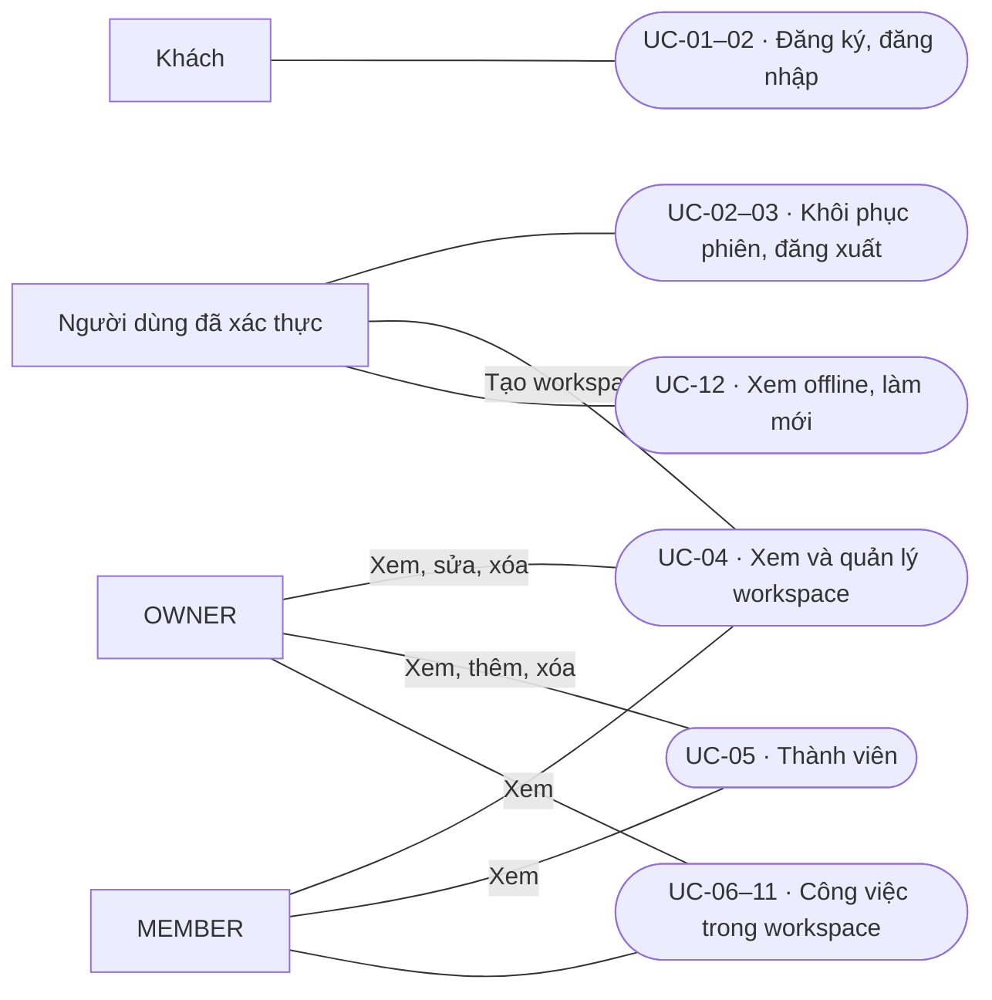

# Use Case Sprintly

Phạm vi P0 theo đặc tả v1.0 ngày 17/11/2026. Các mục ghi **Đề xuất** làm rõ hành vi còn bỏ ngỏ trong đặc tả để nhóm rà soát trước khi triển khai.

Tài liệu liên quan gồm [Đặc tả v1.0](Sprintly_Codex_Implementation_Spec.md), [Phân tích nghiệp vụ](Sprintly_BA.md) và [ERD](Sprintly_ERD.md).

## Tác nhân và quy tắc chung

| Tác nhân | Phạm vi |
|---|---|
| Khách | Đăng ký hoặc đăng nhập. |
| Người dùng đã xác thực | Quản lý phiên và tạo workspace. Quyền với dữ liệu nghiệp vụ phụ thuộc membership của từng workspace. |
| `OWNER` | Có quyền của `MEMBER`, quản lý workspace và thành viên. Quyền xóa project theo đề xuất tại UC-06. |
| `MEMBER` | Xem dữ liệu trong workspace, tạo project, tạo/sửa task, cập nhật trạng thái và bình luận. Quyền sửa project, quản lý cột và xóa task được mô tả tại UC-06 đến UC-08. |
| Ứng dụng và máy chủ | Ứng dụng khôi phục phiên, quản lý dữ liệu đã lưu và làm mới giao diện. Máy chủ xác thực, kiểm tra quyền và xác nhận kết quả ghi. |

- Quyền được kiểm tra ở máy chủ với mỗi tài nguyên được bảo vệ, dựa trên quan hệ tài nguyên → project → workspace → membership khi áp dụng. Tài khoản ngoài workspace bị từ chối với phản hồi `403` hoặc `404` nhất quán theo chính sách API, kể cả khi biết ID.
- Với FR-11, màn hình trình bày trạng thái đang tải, có nội dung, rỗng, lỗi có thử lại hoặc đang xem dữ liệu đã lưu, tùy ngữ cảnh. Khi gửi thao tác, nút gửi bị khóa cho đến khi có kết quả. Xoay màn hình giữ trạng thái cần thiết và tránh gửi lại thao tác, mất task hoặc điều hướng trùng. Khi quay lại ứng dụng, việc làm mới theo UC-12.
- Kiểm tra dữ liệu ở ứng dụng và máy chủ. Tên workspace/project dài 1–100 ký tự, tiêu đề task 1–150 ký tự, bình luận 1–2000 ký tự. Trường sai được báo tại nơi nhập. Thao tác ghi nghiệp vụ cần kết nối theo UC-12.
- **Đề xuất về xóa dữ liệu (QD-04)** Workspace, project và task trong UC-04, UC-06 và UC-08 được xóa vật lý, kéo theo dữ liệu con, gồm bình luận và lịch sử của task bị xóa. Xóa membership theo UC-05 giữ dữ liệu do người dùng đó tạo.

## Sơ đồ tổng quan

## UC-01 Đăng ký

**Tác nhân** Khách.

**Điều kiện trước** Khách mở màn hình đăng ký và có kết nối đến máy chủ.

**Luồng chính**

1. Khách nhập tên hiển thị, email, mật khẩu và xác nhận mật khẩu.
2. Ứng dụng kiểm tra đầu vào, gồm xác nhận mật khẩu trùng khớp, rồi gửi yêu cầu đăng ký.
3. Máy chủ chuẩn hóa email bằng cách bỏ khoảng trắng hai đầu và chuyển sang chữ thường, kiểm tra tính duy nhất, tạo tài khoản và trả phiên theo hợp đồng đăng ký.
4. Ứng dụng lưu phiên an toàn và mở danh sách workspace.

**Ngoại lệ** Email trùng, đầu vào sai hoặc mật khẩu xác nhận sai khiến đăng ký bị từ chối. Khi lỗi kết nối hoặc máy chủ, ứng dụng báo lỗi và cho thao tác lại.

**Điều kiện sau** Khi thành công, tài khoản mới có phiên đăng nhập và có thể tạo workspace. Khi thất bại, ứng dụng giữ người dùng tại luồng đăng ký với thông báo phù hợp.

## UC-02 Đăng nhập và khôi phục phiên

**Tác nhân** Khách hoặc người dùng đã có phiên lưu trên thiết bị.

**Điều kiện trước** Đăng nhập bằng thông tin xác thực cần kết nối đến máy chủ. Khôi phục phiên cần phiên đã lưu.

**Luồng chính**

1. Khách nhập email và mật khẩu. Máy chủ xác thực và cấp access token cùng refresh token.
2. Ứng dụng lưu phiên an toàn và mở danh sách workspace. Khi mở lại, ứng dụng dùng phiên đã lưu nếu còn hợp lệ.
3. Khi API báo access token hết hạn, ứng dụng thực hiện một lượt refresh dùng chung cho các yêu cầu đồng thời. Máy chủ cấp access token mới và xoay vòng refresh token. Ứng dụng lưu token mới và thử lại yêu cầu theo giới hạn.

**Ngoại lệ**

- Sai thông tin xác thực dẫn đến thông báo lỗi tại màn hình đăng nhập.
- Máy chủ từ chối refresh vì phiên hết hạn, bị thu hồi hoặc token không hợp lệ thì ứng dụng xóa phiên, xóa hoặc chặn truy cập cache của tài khoản và về đăng nhập một lần.
- **Đề xuất (QD-06)** Timeout, mất mạng hoặc lỗi máy chủ tạm thời trong lúc refresh giữ phiên cục bộ và chỉ cho đọc cache của tài khoản hiện tại. Ứng dụng thử xác thực lại khi có thể kết nối đến máy chủ. Quy tắc này cần thống nhất với câu chữ về lỗi refresh tại §3.4 và AC-01.

**Điều kiện sau** Phiên hợp lệ cho phép tiếp tục thao tác theo quyền. Phiên bị từ chối dẫn về đăng nhập. Lỗi kết nối tạm thời đi theo UC-12 theo đề xuất trên.

## UC-03 Đăng xuất

**Tác nhân** Người dùng có phiên trên thiết bị.

**Điều kiện trước** Có phiên cục bộ của tài khoản hiện tại.

**Luồng chính**

1. Người dùng chọn đăng xuất trong hồ sơ/cài đặt.
2. Ứng dụng yêu cầu máy chủ thu hồi phiên theo cơ chế best-effort.
3. Ứng dụng xóa phiên cục bộ, xóa hoặc cô lập cache theo tài khoản, rồi về đăng nhập.

**Ngoại lệ** Khi mất mạng hoặc yêu cầu thu hồi lỗi, ứng dụng vẫn dọn phiên và ngăn truy cập cache tại thiết bị. Trạng thái thu hồi trên máy chủ chỉ được xác nhận khi máy chủ xử lý thành công yêu cầu.

**Điều kiện sau** Thiết bị đã đăng xuất và tài khoản tiếp theo chỉ thấy dữ liệu của chính mình. Khi thu hồi thành công, refresh token của phiên cũ bị vô hiệu trên máy chủ.

## UC-04 Xem và quản lý workspace

**Tác nhân** Người dùng đã xác thực, `OWNER`, `MEMBER`.

**Điều kiện trước** Có phiên. Đọc workspace hiện hữu cần membership và ghi cần kết nối.

**Luồng chính**

1. Người dùng mở danh sách workspace mà mình có membership. Có thể chọn một workspace để xem chi tiết, danh sách project và thành viên.
2. Người dùng chọn tạo workspace, nhập tên và mô tả tùy chọn.
3. Máy chủ tạo workspace cùng membership `OWNER` cho người tạo. Ứng dụng mở workspace mới hoặc cập nhật danh sách.
4. Với workspace hiện hữu, `OWNER` có thể sửa tên hoặc mô tả, hoặc xác nhận xóa workspace. Ứng dụng cập nhật danh sách khi máy chủ xác nhận.

**Ngoại lệ** Danh sách chưa có workspace hiển thị trạng thái rỗng. Tên không hợp lệ, ID không tồn tại hoặc quyền không đủ thì hiển thị lỗi phù hợp. Hủy xác nhận xóa kết thúc thao tác tại màn hình hiện tại.

**Điều kiện sau** Danh sách và chi tiết phản ánh những workspace người dùng còn quyền truy cập. Workspace mới có `OWNER` và workspace đã xóa biến mất khỏi danh sách. Quyền sửa/xóa workspace có trong hợp đồng API §5.3 dù FR-02 chỉ liệt kê tạo và xem.

## UC-05 Xem, thêm và xóa thành viên

**Tác nhân** `OWNER`, `MEMBER` của workspace. Người được thêm đã có tài khoản Sprintly.

**Điều kiện trước** Workspace tồn tại. Người thao tác thuộc workspace, với quyền `OWNER` và kết nối để thay đổi membership.

**Luồng chính**

1. Người dùng mở danh sách thành viên cùng vai trò.
2. `OWNER` nhập email chính xác của tài khoản hiện hữu. Máy chủ trả dữ liệu nhận diện tối thiểu cho kết quả khớp. `OWNER` chọn kết quả và xác nhận thêm.
3. Máy chủ thêm membership `MEMBER`. Tài khoản được thêm thấy workspace khi đăng nhập hoặc làm mới danh sách.
4. Khi xóa, `OWNER` chọn thành viên. Máy chủ kiểm tra ràng buộc còn ít nhất một `OWNER` rồi xóa membership. Tài khoản bị xóa mất quyền truy cập qua API và sau khi ứng dụng làm mới.

**Ngoại lệ** Email chưa đăng ký cho kết quả rỗng. Tài khoản đã thuộc workspace, người thao tác thiếu quyền hoặc thao tác xóa `OWNER` cuối cùng đều bị từ chối.

**Điều kiện sau** Danh sách membership phản ánh kết quả đã xác nhận. **Đề xuất** Khi xóa thành viên, giữ tác giả task, bình luận và lịch sử, đồng thời gỡ người phụ trách khỏi các task đang giao cho người đó trong workspace. Việc xóa membership, gỡ assignee, tăng version của task liên quan và ghi audit theo actor thực hiện trong cùng giao dịch.

## UC-06 Xem và quản lý project

**Tác nhân** `OWNER`, `MEMBER`.

**Điều kiện trước** Người dùng thuộc workspace. Các thao tác ghi cần kết nối.

**Luồng chính**

1. Người dùng mở danh sách project trong workspace hoặc chọn project để xem chi tiết.
2. `OWNER` hoặc `MEMBER` nhập tên và mô tả tùy chọn để tạo project. Máy chủ tạo project cùng các cột `To Do`, `In Progress`, `Done` theo thứ tự trong một giao dịch.
3. **Đề xuất** `OWNER` hoặc `MEMBER` có thể sửa tên hoặc mô tả. Khi `OWNER` chọn xóa project, ứng dụng yêu cầu xác nhận.
4. Ứng dụng cập nhật danh sách và màn hình hiện tại theo kết quả máy chủ.

**Ngoại lệ** Danh sách chưa có project hiển thị trạng thái rỗng. Nếu tên không hợp lệ, không đủ quyền, hoặc giao dịch tạo project/cột thất bại, ứng dụng báo lỗi. Lỗi trong giao dịch tạo không để lại project thiếu cột mặc định.

**Điều kiện sau** Project hiển thị trong đúng workspace. Project mới có đúng ba cột mặc định. Project đã xóa không còn xuất hiện trong danh sách hoặc mở được từ board.

## UC-07 Xem board, thêm và đổi tên cột

**Tác nhân** `OWNER`, `MEMBER`.

**Điều kiện trước** Project tồn tại và người dùng thuộc workspace. Thêm và đổi tên cột cần kết nối.

**Luồng chính**

1. Người dùng mở board. Ứng dụng hiển thị cột và task đúng thứ tự máy chủ, cho phép mở chi tiết task.
2. **Đề xuất về phân quyền** `OWNER` và `MEMBER` có thể chọn thêm cột hoặc đổi tên cột hiện hữu.
3. Máy chủ xác thực yêu cầu và cập nhật cột. Khi đổi tên, cột giữ nguyên ID và các task vẫn thuộc cột đó.
4. Ứng dụng hiển thị board theo kết quả máy chủ. Thao tác chuyển task thực hiện theo UC-09.

**Ngoại lệ** Cột chưa có task vẫn được hiển thị. Cột hoặc project không tồn tại, tên không hợp lệ hay thiếu quyền dẫn đến thông báo lỗi. Khi offline, chỉ mở board đã lưu theo UC-12.

**Điều kiện sau** Cột mới hoặc tên mới xuất hiện khi máy chủ xác nhận. P0 hỗ trợ xem, thêm và đổi tên cột.

## UC-08 Xem, tạo, sửa, giao và xóa task

**Tác nhân** `OWNER`, `MEMBER`.

**Điều kiện trước** Người dùng thuộc workspace của project. Thao tác ghi cần kết nối.

**Luồng chính**

1. Người dùng mở task từ board hoặc kết quả tìm kiếm để xem chi tiết.
2. Khi tạo task, người dùng chọn cột thuộc project, nhập tiêu đề và priority (`LOW`, `MEDIUM`, `HIGH`, `URGENT`). Mô tả, hạn hoàn thành và người phụ trách là tùy chọn theo hợp đồng API.
3. Khi sửa, người dùng thay đổi trường cần thiết, có thể chọn hoặc gỡ người phụ trách, rồi gửi cùng `expectedVersion`. Cả `OWNER` và `MEMBER` có quyền giao việc. Máy chủ kiểm tra người được giao hiện thuộc workspace.
4. Máy chủ lưu thay đổi hợp lệ, cập nhật version khi sửa và ghi audit cho thao tác tạo, sửa hoặc giao việc. Ứng dụng cập nhật task theo phản hồi.
5. **Đề xuất** `OWNER` hoặc người tạo task còn là thành viên có thể chọn xóa và xác nhận. Ứng dụng cập nhật board/danh sách sau khi máy chủ xác nhận.

**Ngoại lệ**

- Tiêu đề sai, cột khác project, người phụ trách ngoài workspace hoặc quyền không đủ: máy chủ từ chối thay đổi, ứng dụng hiển thị lý do phù hợp.
- Phiên bản sửa đã cũ: máy chủ trả `409`. Ứng dụng báo xung đột và tải lại dữ liệu hiện tại để người dùng xem xét trước khi gửi lại.
- Khi thao tác thất bại hoặc chưa có phản hồi xác nhận, ứng dụng hiển thị trạng thái phù hợp và cho thử lại khi khả thi.

**Điều kiện sau** Task tạo hoặc sửa xuất hiện với dữ liệu đã xác nhận. Task đã xóa biến mất khỏi các màn hình liên quan. Audit của thao tác tạo, sửa và giao việc truy cập qua UC-10.

## UC-09 Di chuyển task bằng kéo thả

**Tác nhân** `OWNER`, `MEMBER`.

**Điều kiện trước** Đang mở board, thiết bị online, task có version đã tải và chưa có yêu cầu di chuyển đang chờ cho task đó.

**Luồng chính**

1. Người dùng kéo task đến vị trí trong cột đích cùng project. Ứng dụng lưu vị trí cũ, hiển thị ngay vị trí dự đoán và khóa thao tác di chuyển tiếp trên cùng task trong lúc chờ.
2. Ứng dụng gửi `targetColumnId`, `targetIndex` và `expectedVersion`. **Đề xuất** Cho phép đổi vị trí trong cùng cột. `targetIndex` đếm từ 0 trong danh sách đích, sau khi bỏ task đang kéo nếu cột đích trùng cột nguồn. Có thể chèn vào cuối danh sách.
3. Máy chủ kiểm tra quyền, cột đích, vị trí và version, rồi cập nhật thứ tự, version và audit trong giao dịch.
4. Ứng dụng đối chiếu theo vị trí và version máy chủ. Khi phản hồi không đủ dữ liệu về vị trí của các task bị dịch chuyển, ứng dụng làm mới board để đồng bộ toàn bộ thứ tự liên quan.

**Ngoại lệ**

- Version cũ trả `409`. Ứng dụng hoàn tác vị trí dự đoán, báo xung đột và tải lại board. Task tiếp tục có một vị trí hiển thị trong lúc chờ dữ liệu mới.
- Cột đích khác project hoặc vị trí không hợp lệ bị từ chối. **Đề xuất** `targetIndex` ngoài khoảng hợp lệ trả `422`.
- Với lỗi khác, gồm timeout, mất mạng giữa chừng hoặc `500`, ứng dụng hoàn tác và hiển thị thông báo có thể thử lại. Nếu chưa rõ máy chủ đã ghi hay chưa, ứng dụng đối chiếu lại board khi có kết nối trước khi gửi lại.

**Điều kiện sau** Khi thành công, tải lại board vẫn thấy task ở vị trí do máy chủ xác nhận và lịch sử có sự kiện di chuyển. Khi thất bại, giao diện giữ task ở trạng thái hợp lệ và cho biết cách làm mới hoặc thử lại.

## UC-10 Bình luận và xem lịch sử task

**Tác nhân** `OWNER`, `MEMBER`.

**Điều kiện trước** Task tồn tại và người dùng thuộc workspace. Gửi bình luận cần kết nối.

**Luồng chính**

1. Người dùng mở task detail và xem danh sách bình luận cùng lịch sử.
2. Người dùng nhập nội dung bình luận và gửi. Ứng dụng khóa nút gửi khi yêu cầu đang xử lý.
3. Máy chủ lưu nội dung với tác giả và thời gian. Ứng dụng hiển thị bình luận đã xác nhận và khi tải lại vẫn thấy bình luận đó.
4. Người dùng xem lịch sử phân trang. Máy chủ trả các sự kiện create/update/move/assign với tác nhân và thời gian thực tế.

**Ngoại lệ** Bình luận rỗng hoặc quá dài được báo lỗi. Khi mất kết nối hoặc ghi thất bại, ứng dụng hiển thị lỗi và chỉ hiển thị bình luận như đã gửi khi có dữ liệu xác nhận. Task đã xóa hoặc bị mất quyền truy cập sẽ bị từ chối. Offline có thể xem trường task đã lưu và bình luận nếu đã có cache tùy chọn. Lịch sử được tải từ máy chủ.

**Điều kiện sau** Bình luận thành công được lưu, lịch sử phản ánh dữ liệu máy chủ. P0 hỗ trợ đăng/xem bình luận và xem lịch sử.

## UC-11 Tìm kiếm và lọc task

**Tác nhân** `OWNER`, `MEMBER`.

**Điều kiện trước** Người dùng mở tìm kiếm từ một project có quyền truy cập. Luồng truy vấn đầy đủ cần kết nối.

**Luồng chính**

1. Người dùng nhập từ khóa theo tiêu đề và có thể kết hợp bộ lọc theo cột, priority và người phụ trách.
2. Ứng dụng chờ người dùng ngừng gõ trong một khoảng ngắn rồi gửi tiêu chí hiện tại. Máy chủ trả kết quả phân trang theo project và thứ tự ổn định.
3. Người dùng mở một task từ kết quả hoặc xóa bộ lọc để trở về truy vấn rộng hơn. Thao tác đặt lại đưa ô tìm kiếm và bộ lọc về mặc định.

**Ngoại lệ** Truy vấn không khớp hiển thị trạng thái rỗng. Timeout hoặc lỗi máy chủ hiển thị tùy chọn thử lại. Offline vẫn có thể xem board và task đã lưu theo UC-12.

**Điều kiện sau** Kết quả phản ánh từ khóa và bộ lọc hiện tại, giới hạn trong phạm vi truy cập của người dùng.

## UC-12 Xem offline và làm mới khi trở lại online

**Tác nhân** Người dùng có phiên cục bộ, ứng dụng và máy chủ.

**Điều kiện trước** Dữ liệu workspace/project/board/task đã được tải ít nhất một lần để có nội dung hiển thị offline cho tài khoản hiện tại.

**Luồng chính**

1. Khi online, ứng dụng tải và lưu dữ liệu workspace, project, board và task vào Room theo tài khoản. Khi mở màn hình có cache, ứng dụng hiển thị dữ liệu sẵn có trong lúc làm mới nếu có mạng.
2. Khi mất mạng, người dùng vẫn mở dữ liệu đã lưu và thấy banner `Đang xem dữ liệu đã lưu`. Ứng dụng khóa các thao tác ghi nghiệp vụ.
3. Khi có mạng trở lại, người dùng mở lại màn hình, quay lại ứng dụng hoặc kéo để làm mới. Ứng dụng lấy dữ liệu theo phiên và quyền hiện tại, cập nhật cache trong giao dịch rồi hiển thị kết quả mới.
4. Nếu máy chủ xác nhận người dùng đã mất quyền workspace, kể cả khi workspace biến mất khỏi danh sách quyền vừa làm mới đầy đủ, ứng dụng ngừng hiển thị và loại bỏ cache của workspace đó. Nếu máy chủ từ chối phiên, áp dụng UC-02. Đăng xuất và đổi tài khoản áp dụng UC-03.

**Ngoại lệ** Chưa có cache thì hiển thị trạng thái offline rỗng và hướng dẫn thử lại khi có mạng. Lỗi kết nối hoặc timeout khi làm mới giữ dữ liệu đủ quyền đã lưu, kèm trạng thái phù hợp và tùy chọn thử lại. Khi chưa kết nối, ứng dụng dựa vào trạng thái phiên và quyền đã biết tại lần đồng bộ gần nhất.

**Điều kiện sau** Khi offline, người dùng thấy cache thuộc đúng tài khoản. Sau khi làm mới thành công, dữ liệu và quyền truy cập hiển thị theo máy chủ. Các thao tác ghi được thực hiện khi online.

## Truy vết yêu cầu và nghiệm thu

| Yêu cầu | Use case | Điều kiện nghiệm thu liên quan |
|---|---|---|
| FR-01 Phiên đăng nhập | UC-01, UC-02, UC-03 | AC-01 đăng ký, đăng nhập, mở lại app, refresh và thu hồi phiên. |
| FR-02 Workspace | UC-04 | AC-02 tạo workspace và kiểm tra quyền truy cập. |
| FR-03 Thành viên | UC-05 | AC-02 thêm tài khoản hiện hữu, thành viên thấy workspace, người thiếu quyền bị từ chối tại API. |
| FR-04 Project | UC-06 | AC-02 tạo project với đúng ba cột mặc định. |
| FR-05 Board/cột | UC-06, UC-07 | AC-02 cột mặc định. AC-03 board hiển thị task đúng cột sau khi tải lại. |
| FR-06 Task | UC-08 | AC-03 tạo, giao và sửa task. AC-04 lưu audit tương ứng. |
| FR-07 Kéo thả | UC-09 | AC-03 move thành công, rollback/refetch với 500 và 409. AC-04 lưu audit di chuyển. |
| FR-08 Bình luận và lịch sử | UC-10 | AC-04 bình luận còn sau tải lại và audit đúng actor/thời gian. |
| FR-09 Tìm và lọc | UC-11 | AC-05 tìm theo tiêu đề, kết hợp bộ lọc và đặt lại. |
| FR-10 Cache | UC-03, UC-12 | AC-05 board offline, khóa ghi, tải lại online và cách ly cache. |
| FR-11 Trạng thái giao diện | UC-01–UC-12 | Áp dụng xuyên suốt AC-01–AC-05. Ca nghiệm thu cần bao gồm xoay màn hình, timeout, gửi lặp và quay lại ứng dụng theo §8.4. |
| FR-12 Kiểm thử và CI | Tiêu chí chất lượng xuyên suốt | AC-06 thiết lập từ bản checkout sạch, backend tests, Android unit tests, ít nhất một UI test, CI cơ bản không cần secret và dữ liệu demo. |

## Phạm vi sau P0

- P1 gồm thông báo giao việc qua FCM (FR-13) và cập nhật realtime (FR-14).
- P2 gồm ghi offline (FR-15), lời mời link/email có trạng thái chờ và luồng chấp nhận/từ chối (FR-16), và đính kèm (FR-17). §1.3 xếp lời mời chờ vào P1, còn ma trận FR-16 xếp vào P2. Tài liệu dùng mức P2 theo ma trận yêu cầu và dùng email chính xác theo hợp đồng API §5.2 cho UC-05.
